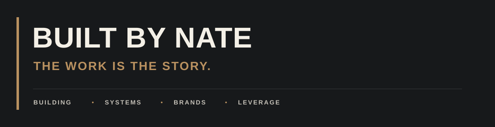

I'm Nathan Welch. Construction field / project management hybrid. Gulf Coast roots.

I build practical tools for the decisions, handoffs, and loose ends that slow the work down. Built By Nate brings that work together: construction, systems, brands, and the leverage to build better.

## THE FOUNDATION

- **BUILDING** · Stay close to the work. Understand the problem before designing the solution.
- **SYSTEMS** · Make the next step clear. Turn repeat problems into repeatable processes.
- **BRANDS** · Give useful work a clear identity and a reason to be remembered.
- **LEVERAGE** · Build tools that make experience useful beyond a single job.

## FIELD NOTES

A practical starting point for scope, prerequisites, open constraints, and the next decision.

**[Use the pre-work readiness checklist →](field-notes/readiness-check.md)**

## ON THE BENCH

Three early-stage concepts in development:

- **FIELDLINE** · Construction readiness.
- **KEEL** · Predevelopment.
- **VERGE** · Contractor intelligence.

These are works in progress, not launched products. I'm developing the ideas around the realities of getting work planned, coordinated, and built.

## FOLLOW THE WORK

If you build, manage projects, or turn field experience into better systems, you're in the right place.

Follow along as the concepts take shape.

**[Explore Built By Nate →](https://itsbuiltbynate.com)**
